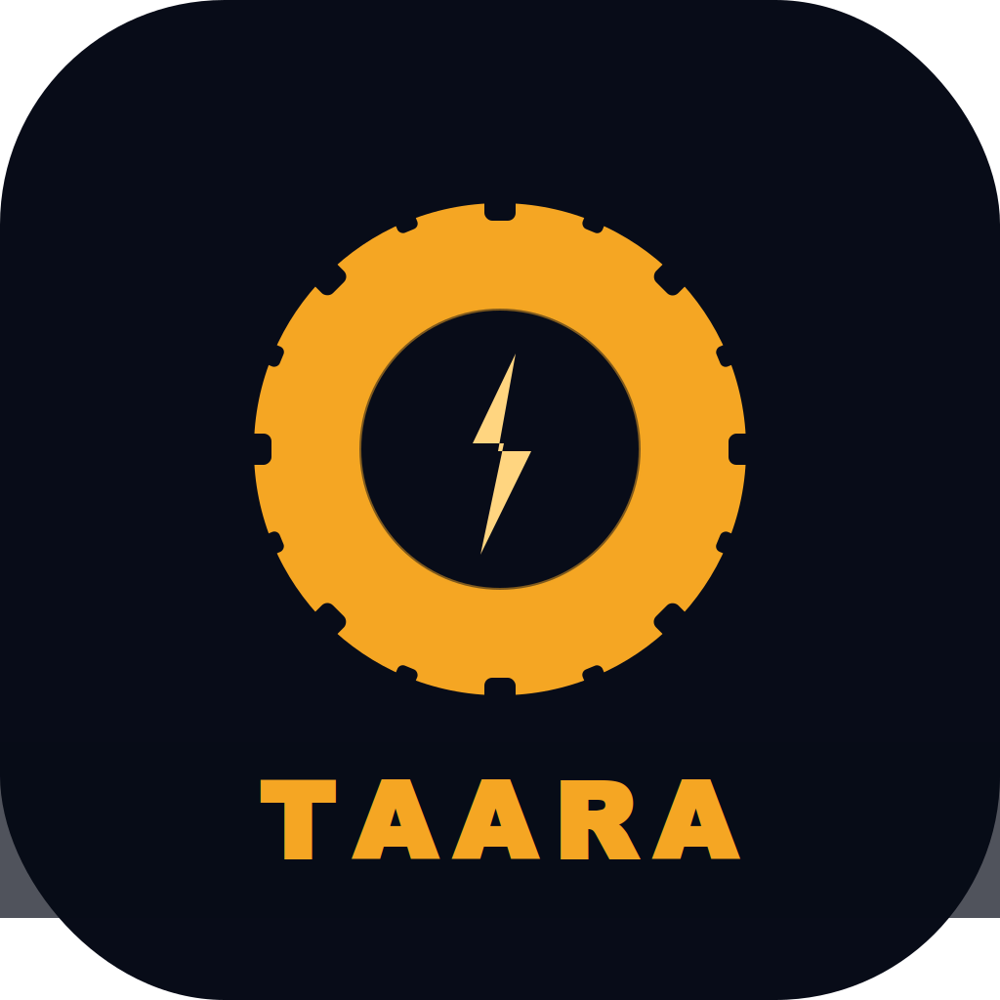

# 🌟 Taara — Light up your repairs. Anywhere. Offline.

<div align="center">



**AI-Powered Repair Diagnostic App built with Gemma 4**

[](https://flutter.dev)
[](https://ai.google.dev)
[](https://android.com)
[](LICENSE)

*Submitted for the **Gemma 4 Good Hackathon** — Kaggle × Google*

[📹 Demo Video](#) · [📱 Download APK](#) · [📄 Kaggle Writeup](#)

</div>

---

## 🌍 The Problem

Every day, **millions of artisans** across Africa and underserved communities worldwide face the same challenge:

> A broken machine. No manual. No expert nearby. No internet.

In Lomé, Togo — a broken alternator means a lost day of income.
A failed pump can destroy a harvest.
A malfunctioning generator can shut down a business for days.

**Over 50 billion devices are discarded every year. Most of them are repairable.**

---

## 💡 The Solution — Taara

**Taara** *(meaning "Light" in Dioula, West Africa)* is a multimodal AI repair diagnostic app that transforms any smartphone into an expert repair assistant — powered by **Gemma 4**.

```
📷 Point camera at broken object
    ↓
🧠 Gemma 4 analyzes in real-time
    ↓
✅ Complete diagnostic + repair guide
    ↓
🔧 Step-by-step repair instructions
```

---

## ✨ Features

| Feature | Description |
|---|---|
| 📷 **Visual Diagnosis** | Camera-based object detection and fault analysis |
| 🎤 **Voice Diagnosis** | Describe the problem verbally — native Android STT |
| 🧠 **Gemma 4 Thinking** | Transparent AI reasoning displayed in real-time |
| 📖 **Repair Guide** | Step-by-step instructions generated by Gemma 4 |
| 📡 **Smart Routing** | Online → Gemma 4 API / Offline → Local cache |
| 💾 **Persistent History** | All diagnostics saved locally (50 entries) |
| 👤 **User Profile** | Personalized experience with stats |
| 🌙 **Dark Mode** | Afro-Tech dark design — easy on the eyes |

---

## 🏗️ Architecture

```
┌─────────────────────────────────────────────┐
│                TAARA APP                     │
│                                             │
│  Flutter Frontend (8 screens)               │
│  ┌──────────┐  ┌──────────┐  ┌──────────┐  │
│  │  Camera  │  │  Voice   │  │ History  │  │
│  │  Scan    │  │  Screen  │  │ Profile  │  │
│  └────┬─────┘  └────┬─────┘  └──────────┘  │
│       │              │                       │
│  ┌────▼──────────────▼─────────────────┐    │
│  │         GemmaService                │    │
│  │  ┌─────────────┐  ┌──────────────┐  │    │
│  │  │ Online Mode │  │ Offline Mode │  │    │
│  │  │ Gemma 4 API │  │ Local Cache  │  │    │
│  │  └─────────────┘  └──────────────┘  │    │
│  └─────────────────────────────────────┘    │
│                                             │
│  HistoryService → SharedPreferences         │
└─────────────────────────────────────────────┘
```

---

## 🤖 Why Gemma 4?

Taara is built **specifically** around Gemma 4's unique capabilities:

- **Multimodal** — Images + text in a single API call
- **Thinking mode** — Transparent reasoning chain displayed to users
- **MoE architecture** — `gemma-4-26b-a4b-it` activates only 4B params per inference → fast responses
- **Multilingual** — French, English, and African languages natively
- **Open & accessible** — Free tier on Google AI Studio → democratizes AI access

---

## 📱 Screenshots

| Splash | Home | Scan | Result |
|---|---|---|---|
| *Coming soon* | *Coming soon* | *Coming soon* | *Coming soon* |

---

## 🚀 Getting Started

### Prerequisites

- Flutter 3.41+
- Android device (API 30+, 4GB+ RAM recommended)
- Google AI Studio API key → [Get one free](https://aistudio.google.com)

### Installation

```bash
# Clone the repository
git clone https://github.com/mkdevfurie/Taara.git
cd Taara

# Install dependencies
flutter pub get

# Run on Android device (configuration injectée à la compilation, rien n'est versionné)
flutter run \
  --dart-define=GEMINI_API_KEY=YOUR_GEMINI_API_KEY \
  --dart-define=TAARA_API_URL=http://10.0.2.2:3000/api/v1

# Build release APK
flutter build apk --split-per-abi --release \
  --dart-define=GEMINI_API_KEY=YOUR_GEMINI_API_KEY \
  --dart-define=TAARA_API_URL=https://api.taara.app/api/v1
```

| Variable | Rôle | Défaut |
|---|---|---|
| `GEMINI_API_KEY` | Diagnostic Gemma 4 en ligne | vide → mode hors-ligne (cache + base embarquée) |
| `TAARA_API_URL` | Backend TAARA ([Taara_backend](https://github.com/mkdevfurie/Taara_backend)) | `http://10.0.2.2:3000/api/v1` (backend local vu depuis l'émulateur) |

En debug, le trafic HTTP en clair est autorisé (backend local) ; les builds release restent en HTTPS.

### Marketplace des réparateurs

Depuis l'écran de résultat, **« Trouver un réparateur »** :

1. liste les pros vérifiés (filtres spécialité / ville) ;
2. demande la connexion (ou l'inscription client / pro) si nécessaire ;
3. envoie le diagnostic Taara au backend et crée la demande avec un budget estimé.

Le suivi se fait dans **Profil → Mes demandes** (client : annuler, discuter, déclarer le paiement en espèces, noter) ou **Mes jobs** (pro : accepter avec un prix, refuser, démarrer, terminer). Le chat client ↔ pro est rafraîchi toutes les 5 s.

### Android Permissions

Make sure your `AndroidManifest.xml` includes:

```xml
<uses-permission android:name="android.permission.CAMERA"/>
<uses-permission android:name="android.permission.RECORD_AUDIO"/>
<uses-permission android:name="android.permission.INTERNET"/>
<uses-permission android:name="android.permission.READ_EXTERNAL_STORAGE"/>
```

---

## 📦 Tech Stack

| Layer | Technology |
|---|---|
| Frontend | Flutter 3.41 |
| AI Engine | Gemma 4 (`gemma-4-26b-a4b-it`) |
| Voice | `speech_to_text` (native Android STT) |
| Camera | `camera` + `image_picker` |
| Storage | `shared_preferences` |
| HTTP | `http` package |
| Fonts | Google Fonts (Poppins + Space Grotesk) |
| Design | Custom Afro-Tech Dark Design System |

---

## 🏆 Hackathon Tracks

This project is submitted for:

- 🥇 **Main Track** — Best overall project
- 🌍 **Global Resilience** — Offline-first for isolated communities
- ⚖️ **Digital Equity** — Voice access for non-literate users
- 📱 **Cactus** — Intelligent online/offline routing

---

## 🌱 Impact

```
🔧 Target Users     → 50M+ artisans in Africa
🌍 Languages        → French, English + local languages  
📴 Works Offline    → Cached diagnostics, no internet needed
♻️ Environmental    → Every repair = one less device in landfill
```

---

## 📁 Project Structure

```
lib/
├── config/
│   └── env.dart              # Config via --dart-define (aucun secret versionné)
├── models/
│   └── diagnostic_model.dart # Data model
├── screens/
│   ├── splash_screen.dart    # Animated splash
│   ├── home_screen.dart      # Dashboard
│   ├── scan_screen.dart      # Camera diagnosis
│   ├── voice_screen.dart     # Voice diagnosis
│   ├── result_screen.dart    # AI results
│   ├── guide_screen.dart     # Repair guide
│   ├── auth_screen.dart      # Connexion / inscription TAARA
│   ├── pros_screen.dart      # Recherche de réparateurs + demande
│   ├── my_jobs_screen.dart   # Suivi demandes (client) / interventions (pro)
│   ├── job_chat_screen.dart  # Chat client ↔ réparateur
│   ├── history_screen.dart   # Diagnostic history
│   └── profile_screen.dart   # User profile
├── services/
│   ├── gemma_service.dart    # Gemma 4 API + cache
│   ├── api_service.dart      # Client backend TAARA (JWT + refresh)
│   └── history_service.dart  # Local persistence
├── theme/
│   └── app_theme.dart        # Design system
├── widgets/
│   └── global_widgets.dart   # Reusable components
└── main.dart
```

---

## 🔐 Security

- API key injected at build time with `--dart-define` (never committed)
- Diagnostics stay on the device unless the user sends a repair request to a professional (then sent to the TAARA backend)
- All history stored locally on device
- No analytics or tracking

---

## 📄 License

This project is licensed under **CC-BY 4.0** as required by the Gemma 4 Good Hackathon rules.

---

## 👤 Author

**MKfery** — [@mkdevfurie](https://github.com/mkdevfurie)

Built with ❤️ in Lomé, Togo 🇹🇬

---

<div align="center">

**Taara — Because the right to repair belongs to everyone.**

*Powered by Gemma 4 · Built for the Gemma 4 Good Hackathon*

</div>